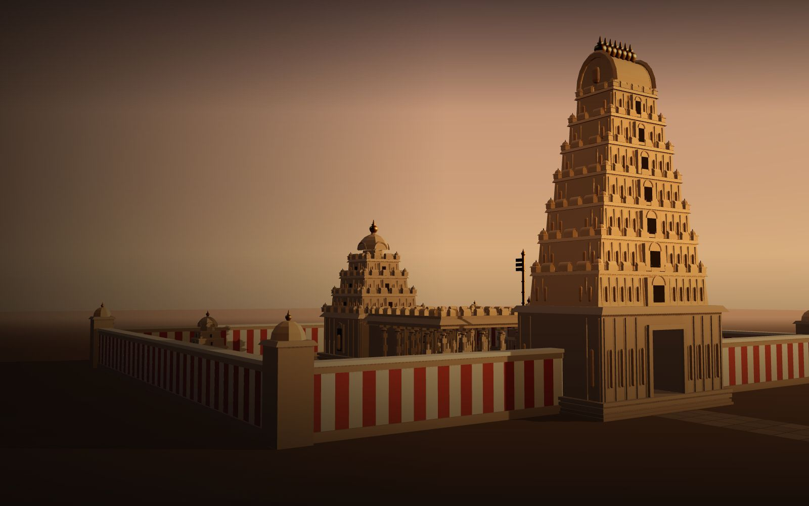

# Sanatan — a Dravidian temple in 3D

A cinematic, interactive 3D website for exploring a South Indian temple: the tiered gateway tower
(gopuram), its crowning vault and kalashas, the flagstaff (dhvajastambha), the pillared hall
(mandapa), the tower over the sanctum (vimana) and the stepped temple tank (pushkarini).

> **The temple is fictional.** It is an original, stylised model *inspired by* Dravidian temple
> architecture, built procedurally for this project. It does not reproduce any specific historic
> temple. Landmark descriptions explain general architectural terms and link to their sources; a
> separate "In this model" note describes what this particular model shows.



## Features

- **Cinematic landing** — golden-hour establishing shot with a slow camera sway, hero copy and a
  working *Explore the temple* transition.
- **Real interactive 3D model** — `public/models/temple.glb` (~100k triangles, 1.55 MB,
  meshopt-compressed), rendered with React Three Fiber.
- **Free exploration** — orbit (drag), zoom (wheel / pinch), pan (right-drag / two fingers), with
  distance, angle and target limits; **Reset view**. With the 3D view focused: arrow keys orbit,
  Shift + arrows pan, `+` / `−` zoom.
- **Six landmarks** — select from the landmark list, the numbered 3D markers, or by clicking the
  building itself. The camera glides to a curated pose, the landmark glows, and an information
  panel opens (previous / next / close / Escape).
- **Loading, failure and fallback states** — real load progress; a clear error with a working
  *Try again*; browsers without WebGL get a still of the model and all landmark descriptions.
- **Responsive and accessible** — desktop, tablet and phone layouts; ≥44 px touch targets; visible
  focus; keyboard-operable controls; `prefers-reduced-motion` disables the camera sway and
  transitions; no axe-core violations in the tested states.
- **Efficient rendering** — the 3D scene loads as a separate chunk after the landing UI; the canvas
  renders on demand when nothing is moving.

## Quick start

Prerequisites: **Node.js 20.19+ or 22.12+** and npm.

```bash
npm install
npm run dev        # http://localhost:5173
```

Production build and local preview:

```bash
npm run build      # type-checks, then builds to dist/
npm run preview    # serves dist/ at http://localhost:4173
```

No environment variables, API keys or backend are required. `dist/` is a static site that can be
hosted on any static host (nothing has been deployed).

## Scripts

| Script | What it does |
|---|---|
| `npm run dev` | Vite dev server |
| `npm run build` | `tsc -b` type-check + production build |
| `npm run typecheck` | TypeScript project check only |
| `npm run lint` | oxlint |
| `npm test` | Vitest unit tests (state reducer, GLB integrity, landmark ↔ model checks) |
| `npm run smoke` | Browser smoke test of the **built** app in the locally installed Chrome (headless, via `playwright-core`; no browser download). Run `npm run build` first. Screenshots go to `smoke-output/`. Set `SMOKE_CHANNEL=msedge` to use Edge. |
| `npm run perf` | Rough FPS / draw-call / triangle probe on the hardware GPU (`PERF_SOFTWARE=1` for SwiftShader) |
| `npm run build:model` | Regenerates `public/models/temple.glb` from `scripts/build-temple-model.mjs` |
| `npm run capture:poster` | Re-captures `public/images/temple-poster.jpg` from the built app (run after changing the model or lighting) |

## Architecture

```text
scripts/
  build-temple-model.mjs   procedural model → three.js GLTFExporter → glTF-Transform (dedup, meshopt)
  smoke.mjs, smoke-scenarios.mjs, perf.mjs, capture-poster.mjs
src/
  App.tsx                  shell: landing ↔ explore, scene status, lazy 3D chunk, overlays
  state/exploration.ts     reducer: mode, selected landmark, reset nonce (unit-tested)
  data/landmarks.ts        typed landmark records (node name, anchor, camera pose, text, sources)
  data/temple.ts           model URL, camera poses and limits
  scene/                   R3F: TempleCanvas, TempleModel (highlight + picking), CameraRig,
                           Hotspots, Lighting (gradient sky, fog, sun, local environment)
  components/              HTML UI: Header, Hero, ExploreHud, LandmarkPanel, AboutDialog, status
public/models/temple.glb   the model; public/images/temple-poster.jpg the WebGL-less fallback
```

React state holds only *what* is selected and the UI mode. All camera motion is imperative inside
`CameraRig` (Drei `CameraControls`), so there is no per-frame React state. Landmarks are data:
each record names the GLB node it highlights and the camera pose used to frame it. Unit tests check
that every anchor lies on its node and that no camera pose sits inside a building.

### Swapping in another model

1. Put the GLB in `public/models/` and set `TEMPLE_MODEL.url` in `src/data/temple.ts`.
2. Update `src/data/landmarks.ts`: `nodeName` (a node in the new file), `anchor`, and `camera`
   for each landmark. Keep descriptions general unless you have reliable sources for that temple.
3. Adjust `LANDING_POSE`, `OVERVIEW_POSE` and `CAMERA_LIMITS` in `src/data/temple.ts`.
4. Run `npm test` (the integrity tests will flag missing nodes or bad poses), `npm run build`,
   `npm run smoke` and `npm run capture:poster`.
5. Credit the asset in `docs/ASSET_CREDITS.md` and the About dialog.

Openly licensed (CC BY 4.0) Sketchfab candidates are listed in `docs/ASSET_CREDITS.md`. They were not
used because downloading requires a signed-in Sketchfab account.

## Credits

- Temple model and poster: original work for this project.
- Typefaces: Cormorant Garamond (The Cormorant Project Authors) and Inter (The Inter Project
  Authors), SIL Open Font License 1.1, via Fontsource.
- Libraries: React, Three.js, React Three Fiber, Drei (MIT) and others listed in `package.json`.

Full details: [`docs/ASSET_CREDITS.md`](docs/ASSET_CREDITS.md). Project history and verification
evidence: [`docs/BUILD_LOG.md`](docs/BUILD_LOG.md); limitations: [`docs/KNOWN_ISSUES.md`](docs/KNOWN_ISSUES.md).
